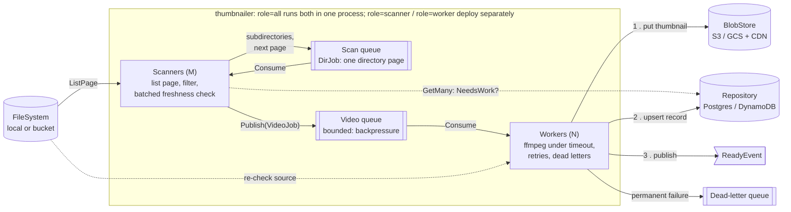

# thumbnailer

Scans a file system (local or remote, behind an interface) for videos and generates thumbnails with ffmpeg.
Built as a long-running service, with production concerns in mind: bounded memory, bounded concurrency,
horizontally scalable scanning, supervised external processes, retries, idempotency and graceful shutdown.

```sh
make test                      # full suite (real-ffmpeg smoke tests skip if ffmpeg is missing)
make race                      # same, under the race detector
make demo ROOT=~/Movies        # one pass over a directory; thumbnails land in ./data/blobs
make load FILES=1000000        # load test against a generated million-file tree (no disk use)
./bin/thumbnailer -root /videos -health-addr :8080   # long-running: rescans every 5 minutes
```

## Architecture

One binary with two modules, each driven by its own work queue:



- **The walk runs on a queue.** Each job is one page of one directory. Listing a page publishes a job for every
  subdirectory and for the next page, then the videos that need work. Any number of scanners can share the scan
  queue, so listing parallelizes across directories. A huge directory splits into independent pages. The queue is
  also the checkpoint: an unfinished page is simply redelivered.
- **Listing returns metadata** (size, mtime, ETag), the way S3's `ListObjectsV2` does, so scanning needs no per-file
  stat. Freshness is checked with **one batched lookup per page** (`Repository.GetMany`), not one query per file.
- **The scan queue is unbounded; the video queue is bounded.** Scanners both consume and publish to the scan queue,
  so a capacity limit there could deadlock them, all blocked on a publish only they could make room for.
  Backpressure comes from the video queue: when workers fall behind, scanners block publishing videos.
- **Modular monolith, deployable as two roles.** Scanners do cheap I/O; workers are CPU-heavy. Each scales on its own
  queue's depth. Running the roles separately needs a broker adapter (`queue.Queue` over Pub/Sub or SQS).
- **Work-queue semantics, not a log.** At-least-once delivery, per-message ack/nack, delayed redelivery and a
  dead-letter queue. That's Pub/Sub or SQS rather than Kafka, where one slow ffmpeg job would hold up its whole
  partition.
- **Scale workers on queue depth / age of the oldest message**, not on file size. Grabbing one frame costs about the
  same whatever the file size (bounded decode via the `thumbnail` filter).
- **In production, bucket change notifications would feed the video queue.** The scan then handles backfill and
  reconciliation, and doubles as a sweep that re-sends lost "ready" events. At hundreds of millions of keys, a
  storage inventory report (S3 Inventory) would replace listing for reconciliation.

## Pipeline stages and how each one fails safely

| Stage | Where | Failure handling |
|---|---|---|
| **Walk** | `scanner/scanner.go` | One directory page per job, listed by M scanners in parallel. A pass ends when an outstanding-job counter reaches zero (+1 before each job is published, −1 when one is acked or dead-lettered). A listing error is retried with a delay; a directory that keeps failing is dead-lettered and the rest of the scan continues. A directory deleted mid-scan is skipped. Symlinks are skipped. |
| **Read** | `scanner/scanner.go`, `worker/runner.go` | Freshness is checked per page against the repository (`NeedsWork`), so re-runs are cheap. Changes are detected by ETag, or size+mtime when there's no ETag. Fails open: if the repository is down, the page's videos are published anyway. The worker re-checks the source before running ffmpeg (it may have changed or been deleted while queued) and again before writing anything (it may have changed while ffmpeg ran). Either way the job steps aside as superseded, so a slow job for an old version can't overwrite a newer version's record. |
| **Process** | `worker/runprocess.go`, `failures.go` | Oversized inputs are rejected before ffmpeg starts. A timeout triggers kill, with SIGTERM escalating to SIGKILL. An unkillable process is abandoned and alerted on, so it can't hold the worker slot. stderr is classified: corrupt input, no video stream, unsupported codec or missing file are **permanent** and go straight to the dead-letter queue; anything else is **transient** and retried with exponential backoff and jitter through the queue. A zero exit code isn't trusted: missing, empty, oversized or non-image output (checked by magic bytes) counts as a failure. |
| **Write** | `worker/runner.go`, `storage/` | Order is blob → record → event. The blob key `thumbnails/{shard}/{sha(path)}/{sha(version)}.jpg` is deterministic and immutable, so a retry overwrites the same object and CDN caches never need purging. Image bytes go to object storage; metadata goes to a database. |
| **Done** | `worker/runner.go` | Ack only after commit. `ReadyEvent` is published, then `Notified` is set. A ready thumbnail is **never** downgraded to failed or dead-lettered. If the event bus stays down, the job is acked and the next scan re-sends the event. |

Shutdown has two phases: stop taking jobs, give in-flight ones `ShutdownGrace` to finish, then kill their ffmpeg
processes and return those jobs to the queue. A second signal exits immediately.

## Testing

- **Virtual time** (`testing/synctest`): timeouts, backoff, grace periods and latency run in microseconds and are
  asserted to the millisecond. A goroutine stuck with no timer pending fails the test as a deadlock instead of hanging it.
- **Fakes with fault injection** (`internal/testkit`):
  - an in-memory file system (paged listing, per-path and transient listing errors, latency, symlinks);
  - a scriptable ffmpeg (succeed, fail with given stderr, hang, ignore N kills, bad output, spawn failure);
  - storage wrappers that fail next, always, or randomly.
- **One suite per stage**: walk, read, process (timeout / process error / size limits / corrupt data), write, done.
  The walk suite checks, among other things, that 73 directories with 20 ms listings finish in exactly 10 rounds of
  parallel listing, and that no file is ever stat'ed during a scan.
- **Property test** (`rapid`): for random trees, page sizes, scanner concurrency and transient listing failures,
  every video is published and the pass completes with the scan queue drained.
- **Chaos test** (`app/chaos_test.go`): about 1k videos with every failure mode at once, 5% storage and event bus
  faults, transient listing failures on 20% of directories and 7-entry pages, over 5 seeds. It checks the invariants:
  exactly one final state per video, no leaked processes, no scratch files left, the concurrency cap held, counters
  reconcile, and one more scan delivers every deferred event. `make chaos SEED=n` reproduces a seed. It found a real
  bug during development: a ready thumbnail could be overwritten as failed.
- **Smoke tests against real ffmpeg**: real stderr checked against the classifier (truncated mp4, garbage bytes,
  audio-only, missing file). A real hang (a FIFO with no writer) checks the kill path. A full end-to-end run uses the
  real file system, ffmpeg and SQLite.
- **Mutation check**: bugs injected by hand (no kill on timeout, downgrade of ready records, size limit skipped,
  output not validated) all make the suite fail. The exception is the queue's lost wake-up, a scheduler-timing bug
  that a black-box test only catches occasionally. It's prevented structurally instead: every state change and its
  notification happen in one critical section.

## Load testing

`cmd/loadrun` runs the real service against a **generated file system** (`internal/loadtest`). The tree is computed
from a seed, so millions of files cost no disk, setup or cleanup. Each video's behavior comes from a hash of its
path: ok, corrupt, slow, hang or flaky. An in-process fake ffmpeg acts it out. `LatencyFS` adds per-call latency to
mimic an object store. The report validates the end state against the tree's census (`"ok": true`).

```sh
make load FILES=1000000
make load FILES=200000 ARGS="-list-latency 20ms -open-latency 5ms -scan-concurrency 64"
```

M-series laptop, 64 workers, 1 ms simulated ffmpeg, 90% of files are videos. "Before" is the original single walker
(one directory at a time, a stat per file, a repository query per file); "after" is the queue-driven scanner.

| Scenario | Before | After |
|---|---|---|
| 200k files, 20 ms list / 5 ms stat, cold run | 2 m 0 s | 22 s (now worker-bound) |
| 200k files, 20 ms list / 5 ms stat, rescan, 16 scanners | 2 m 2 s | 2.7 s |
| 200k files, 20 ms list / 5 ms stat, rescan, 64 scanners | 1 m 5 s | 0.73 s |
| 1M files, no latency, rescan | 2.0 s | 0.48 s |
| `OpenFile` calls, 1M files, cold run | 1.93M | 0.92M (all from the worker's source check) |
| Repository queries, 1M files, rescan | 900k | 10k (one per page) |

Before, the scanner was the bottleneck: workers starved (peak queue depth 36), and a 20 ms list per directory, done
one directory at a time, set a floor no walk concurrency could remove. After, the video queue stays full (depth
~1,070) and throughput is set by the workers, which is the part that scales horizontally. A no-op rescan of 200k
files went from two minutes to under a second.

## Layout

```
cmd/thumbnailer/     entry point: flags → real adapters → service; signal handling, health server
cmd/loadrun/         load-test entry point
internal/domain/     interfaces + types (FileSystem, Process, BlobStore, Repository, ...)
internal/scanner/    queue-driven scanner (one directory page per job), filters
internal/queue/      Queue interface + in-memory implementation
internal/worker/     runner (one job end to end), process supervision, failure classification, worker pool
internal/storage/    blob key scheme, in-memory stores
internal/adapters/   OS file system, ffmpeg, scratch dir, local blob store, SQLite
internal/app/        config, service lifecycle (roles, scan loop), health endpoint
internal/testkit/    fakes, fault injection, harness (test-only)
internal/loadtest/   generated file system, latency wrapper, in-process fake ffmpeg, load-run report
```

## Known limits / next steps

- **Broker adapter** (Pub/Sub or SQS) for split deployments. The in-memory queues lose their backlog on restart; the
  next scan rebuilds it from the root.
- **Pass completion across replicas.** The outstanding-job counter lives in process memory. Several scanner
  replicas would keep it in shared storage (an atomic counter per pass), or not track passes at all and let a
  scheduler start one per interval.
- **Duplicate directory jobs.** A scanner that crashes after publishing a page's subdirectories but before acking
  causes those subdirectories to be listed twice. That's harmless (video jobs are idempotent) but wasteful at scale;
  broker-side deduplication on `(dir, pageToken, pass)` would remove it.
- **Scan frontier.** The scan queue is FIFO, so it holds a whole level of the tree at once. In memory that's fine for
  millions of directories; a broker stores it anyway.
- **Local paging is O(n) per page.** POSIX has no listing cursor that survives between calls, so each page re-reads
  the directory. Object stores page natively.
- **Symlinks are skipped.** Following them across replicas needs shared loop detection.
- **Concurrent jobs for the same video.** Two guards are read-then-write, so each leaves a millisecond-wide race:
  "never downgrade ready" (duplicate deliveries of one version), and the pre-commit source re-check (a slow job for
  v1 finishing after a job for v2 committed; found by an external review). Both self-heal on the next scan, at the
  cost of a stale window and a duplicate event. Two ways to close them fully:
  - a conditional write in the database that only lets newer versions win, ordered by source mtime (ETags can't be
    ordered), for example `ON CONFLICT … DO UPDATE … WHERE excluded.source_mtime >= thumbnails.source_mtime`;
  - per-path ordering at the broker, so only one job per video runs at a time: an SQS FIFO queue with
    `MessageGroupId = video_path`, or Pub/Sub ordering keys.
- **Exactly-once events** need a transactional outbox. Today they are at-least-once, and duplicates are identical, so
  consumers can dedupe on `(videoPath, sourceVersion)`.
- **Metrics** are in-process counters on `/healthz`; production would export them to Prometheus or OpenTelemetry.
