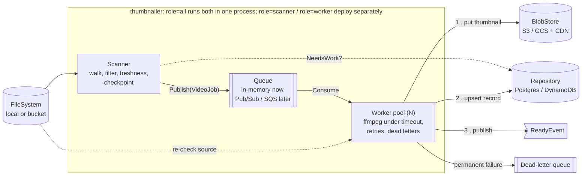

# thumbnailer

Scans a file system (local or remote, behind an interface) for videos and generates thumbnails with ffmpeg.
Built as a long-running service, with production concerns in mind: bounded memory, bounded concurrency,
supervised external processes, retries, idempotency and graceful shutdown.

```sh
make test                      # full suite (real-ffmpeg smoke tests skip if ffmpeg is missing)
make race                      # same, under the race detector
make demo ROOT=~/Movies        # one pass over a directory; thumbnails land in ./data/blobs
./bin/thumbnailer -root /videos -health-addr :8080   # long-running: rescans every 5 minutes
```

## Architecture

One binary with two modules that only talk through a `queue.Queue` interface:



- **Modular monolith, deployable as two roles.** The scanner does cheap I/O and runs as a single instance. Workers
  are CPU-heavy and scale out. Those different scaling needs are the reason for the split, and it costs only a flag.
  Running both roles separately needs a broker adapter (`queue.Queue` over Pub/Sub or SQS), which is the next step.
- **Work-queue semantics, not a log.** At-least-once delivery, per-message ack/nack, delayed redelivery and a
  dead-letter queue. That's Pub/Sub or SQS rather than Kafka, where one slow ffmpeg job would hold up its whole
  partition.
- **Scale workers on queue depth / age of the oldest message**, not on file size. Grabbing one frame costs about the
  same whatever the file size (bounded decode via the `thumbnail` filter).
- **In production, bucket change notifications would feed the queue.** The scanner then handles backfill and
  reconciliation, and doubles as a sweep that re-sends lost "ready" events.

## Pipeline stages and how each one fails safely

| Stage | Where | Failure handling |
|---|---|---|
| **Walk** | `scanner/walker.go` | Iterative depth-first walk exposed as an `iter.Seq`, so memory stays flat and deep trees can't overflow the stack. Backpressure comes from the consumer pulling. A directory that can't be listed, or a file that can't be opened, is logged and skipped. Symlink loops are detected through canonical paths. Checkpoints let a restart resume with nothing missed and at most `CheckpointEvery` files repeated. |
| **Read** | `scanner/scanner.go`, `worker/runner.go` | Freshness is checked against the repository (`NeedsWork`), so re-runs are cheap. Changes are detected by etag, or size+mtime when there's no etag. Fails open: if the repository is down, the job is published anyway. The worker re-checks the source before running ffmpeg, in case the file changed or was deleted while queued. |
| **Process** | `worker/runprocess.go`, `failures.go` | Oversized inputs are rejected before ffmpeg starts. A timeout triggers kill, with SIGTERM escalating to SIGKILL. An unkillable process is abandoned and alerted on, so it can't hold the worker slot. stderr is classified: corrupt input, no video stream, unsupported codec or missing file are **permanent** and go straight to the dead-letter queue; anything else is **transient** and retried with exponential backoff and jitter through the queue. A zero exit code isn't trusted: missing, empty, oversized or non-image output (checked by magic bytes) counts as a failure. |
| **Write** | `worker/runner.go`, `storage/` | Order is blob → record → event. The blob key `thumbnails/{shard}/{sha(path)}/{sha(version)}.jpg` is deterministic and immutable, so a retry overwrites the same object and CDN caches never need purging. Image bytes go to object storage; metadata goes to a database. |
| **Done** | `worker/runner.go` | Ack only after commit. `ReadyEvent` is published, then `Notified` is set. A ready thumbnail is **never** downgraded to failed or dead-lettered. If the event bus stays down, the job is acked and the next scan re-sends the event. |

Shutdown has two phases: stop taking jobs, give in-flight ones `ShutdownGrace` to finish, then kill their ffmpeg
processes and return those jobs to the queue. A second signal exits immediately.

## Testing

About 3.3k lines of tests to about 2.3k lines of code; 94% statement coverage across `internal/`.

- **Virtual time** (`testing/synctest`): timeouts, backoff, grace periods and latency run in microseconds and are
  asserted to the millisecond. A goroutine stuck with no timer pending fails the test as a deadlock instead of hanging it.
- **Fakes with fault injection** (`internal/testkit`):
  - an in-memory file system (per-path errors, latency, files vanishing mid-scan, symlink loops);
  - a scriptable ffmpeg (succeed, fail with given stderr, hang, ignore N kills, bad output, spawn failure);
  - storage wrappers that fail next, always, or randomly.
- **One suite per stage**: walk, read, process (timeout / process error / size limits / corrupt data), write, done.
- **Property test** (`rapid`): for random trees and random crash points, walk + checkpoint + resume yields every file
  exactly once.
- **Chaos test** (`app/chaos_test.go`): about 1k videos with every failure mode at once plus 5% storage and event bus
  faults, over 5 seeds. It checks the invariants: exactly one final state per video, no leaked processes, no scratch
  files left, the concurrency cap held, counters reconcile, and one more scan delivers every deferred event.
  `make chaos SEED=n` reproduces a seed. It found a real bug during development: a ready thumbnail could be
  overwritten as failed.
- **Smoke tests against real ffmpeg**: real stderr checked against the classifier (truncated mp4, garbage bytes,
  audio-only, missing file). A real hang (a FIFO with no writer) checks the kill path. A full end-to-end run uses the
  real file system, ffmpeg and SQLite.
- **Mutation check**: bugs injected by hand (no kill on timeout, downgrade of ready records, checkpoint saved before
  publish, size limit skipped, output not validated) all make the suite fail. The exception is the queue's lost
  wake-up, a scheduler-timing bug that a black-box test only catches occasionally. It's prevented structurally
  instead: every state change and its notification happen in one critical section.

## Load testing

`cmd/loadrun` runs the real service against a **generated file system** (`internal/loadtest`). The tree is computed
from a seed, so millions of files cost no disk, setup or cleanup. Each video's behavior comes from a hash of its
path: ok, corrupt, slow, hang or flaky. An in-process fake ffmpeg acts it out. `LatencyFS` adds per-call latency to
mimic an object store. The report validates the end state against the tree's census (`"ok": true`).

```sh
make load FILES=1000000
make load FILES=200000 ARGS="-list-latency 20ms -open-latency 5ms -walk-concurrency 64"
```

Baseline (M-series laptop, 64 workers, 1 ms simulated ffmpeg, 90% of files are videos):

| Scenario | Scan | Files/s scanned | `OpenFile` calls | Peak heap |
|---|---|---|---|---|
| 1M files, no latency, cold | 30 s (paced by workers) | 33k | 1.93M | 226 MB |
| 1M files, no latency, rescan (all up to date) | 2.0 s | 500k | 1.01M | 256 MB |
| 200k files, 20 ms list / 5 ms stat, walk-concurrency 16 | 2 m 0 s | 1.7k | 386k | — |
| 200k files, 20 ms list / 5 ms stat, walk-concurrency 64 | 1 m 5 s | 3.1k | 386k | — |

With object-store latency **the scanner is the bottleneck**: workers starve (peak queue depth 36). Directories are
listed one at a time, so a 20 ms list per directory sets a floor that no amount of walk concurrency removes. At 1M
files that floor is ≥ 200 s; at 10M, over half an hour. A no-op rescan costs as much as a cold one. And every file is
stat'ed twice: once by the walker, once by the worker's source check.

## Layout

```
cmd/thumbnailer/     entry point: flags → real adapters → service; signal handling, health server
internal/domain/     interfaces + types (FileSystem, Process, BlobStore, Repository, ...)
internal/scanner/    walker, filters, checkpoints, scanner
internal/queue/      Queue interface + in-memory implementation
internal/worker/     runner (one job end to end), process supervision, failure classification, worker pool
internal/storage/    blob key scheme, in-memory stores
internal/adapters/   OS file system, ffmpeg, scratch dir, local blob store, SQLite, checkpoint file
internal/app/        config, service lifecycle (roles, scan loop), health endpoint
internal/testkit/    fakes, fault injection, harness (test-only)
internal/loadtest/   generated file system, latency wrapper, in-process fake ffmpeg, load-run report
cmd/loadrun/         load-test entry point
```

## Known limits / next steps

- **Broker adapter** (Pub/Sub or SQS) for split deployments. The in-memory queue loses its backlog on restart; the
  next scan rebuilds it.
- **Conditional writes.** "Never downgrade ready" is a read-then-write guard. Fully closing the race between
  concurrent duplicate deliveries needs `UPDATE … WHERE status <> 'ready'` in the database.
- **Exactly-once events** need a transactional outbox. Today they are at-least-once, and duplicates are identical, so
  consumers can dedupe on `(videoPath, sourceVersion)`.
- **Paginated listing** (`ListFiles` returns a whole directory) for object stores with millions of keys per prefix.
- **Single scanner** is assumed; running several would need a lease or leader election.
- **Metrics** are in-process counters on `/healthz`; production would export them to Prometheus or OpenTelemetry.
